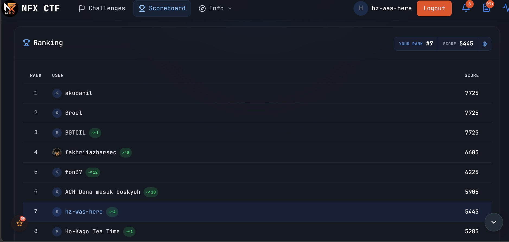

# NFX CTF 2026 — Official Writeups

Dokumentasi lengkap penyelesaian challenge NFX CTF 2026 oleh **[Hzkun001](https://github.com/Hzkun001)** (`hz-was-here`).  
Repositori ini memuat **33 writeup teknis** yang mencakup kategori **Medium, Hard, dan Insane**.

---

## Profil Peserta & Scoreboard

> [!IMPORTANT]
> **Catatan Posisi Scoreboard:**  
> Saat acara/kompetisi selesai, posisi akun seharusnya berada di **Peringkat #5**. Pada tampilan antarmuka live dashboard saat tangkapan layar diambil (sekitar pukul 22:15 WIB, 13 November 2026), sistem mencatat posisi di **Peringkat #7** (5.445 poin). Bukti tangkapan layar dashboard tetap dilampirkan apa adanya untuk transparansi penilaian oleh panitia.

<p align="center">
  
</p>

| Parameter | Keterangan |
| --- | --- |
| **Username CTF** | `hz-was-here` |
| **Track** | **Track Umum** |
| **GitHub** | [Hzkun001](https://github.com/Hzkun001) |
| **Platform** | NFX CTF (`ctf.nfx.my.id`) |
| **Posisi Saat Selesai Acara** | **Peringkat #5** |
| **Posisi Tercatat di Snapshot** | **Peringkat #7** (5.445 poin) |
| **Total Solve Terdokumentasi** | **33 Challenge** (23 Medium, 9 Hard, 1 Insane) |
| **Bukti Arsip** | [assets/scoreboard/README.md](assets/scoreboard/README.md) |

---

## Rekapitulasi Challenge & Daftar Writeup

Seluruh challenge dikelompokkan berdasarkan tingkat kesulitan dan kategori resmi kompetisi:

### Ringkasan per Kategori

| Kategori | Medium | Hard | Insane | Total |
| --- | :---: | :---: | :---: | :---: |
| **Web Exploitation** | 2 | - | - | 2 |
| **Binary Exploitation (Pwn)** | 2 | 1 | 1 | 4 |
| **Reverse Engineering** | 2 | 3 | - | 5 |
| **Cryptography** | 7 | 2 | - | 9 |
| **Forensics** | 2 | 1 | - | 3 |
| **Miscellaneous & Logic** | 5 | 1 | - | 6 |
| **Boot to Root** | 1 | - | - | 1 |
| **OSINT** | 2 | 1 | - | 3 |
| **TOTAL** | **23** | **9** | **1** | **33** |

---

### 1. Difficulty: Medium (23 Solves)
Indeks lengkap: **[medium/README.md](medium/README.md)**

* **Web Exploitation:**
  * [NexaPartner](medium/web-exploitation/nexapartner/README.md) — Prototype pollution pada endpoint settings untuk privilege escalation ke admin audit.
  * [NexaIdentity](medium/web-exploitation/nexaidentity/README.md) — SQL Injection / authentication bypass pada mekanisme token identity console.
* **Cryptography:**
  * [Black Box Protocol N4T0](medium/crypto/blackbox-protocol-n4t0/README.md) — Dekode protokol transmisi NATO fonetik & deobfuskasi manifes spreadsheet.
  * [ECDSA Nonce Bias](medium/crypto/ecdsa-nonce-bias/README.md) — Rekonstruksi private key ECDSA dengan memanfaatkan bias LSB nonce (Hidden Number Problem).
  * [Unbreakable Delay](medium/crypto/unbreakable-delay/README.md) — Bypass time-lock puzzle / sequential delay memanfaatkan optimasi modular arithmetic.
  * [Feistel Differential](medium/crypto/feistel-differential/README.md) — Analisis differential cryptanalysis pada struktur cipher Feistel 4-round.
  * [Cihuy LWE](medium/crypto/cihuy-lwe/README.md) — Penyelesaian Learning With Errors (LWE) via reduksi basis kisi (lattice LLL reduction).
  * [Static IV Offline](medium/crypto/static-iv-offline/README.md) — Serangan static Initialization Vector pada mode enkripsi CBC/CTR offline.
  * [RSA Coppersmith Cihuy](medium/crypto/rsa-coppersmith-cihuy/README.md) — Pemulihan plaintext RSA stereotipikal dengan teorema Coppersmith small root.
* **Miscellaneous & Logic:**
  * [Dokodemo Door](medium/miscellaneous-logic/dokodemo-door/README.md) — Analisis pergerakan logika maze teleportasi state stateful.
  * [The Alchemist's Sandbox](medium/miscellaneous-logic/the-alchemists-sandbox/README.md) — Bypass sandbox Python restricted execution / builtins recovery.
  * [Stay](medium/miscellaneous-logic/stay/README.md) — Logika automata & traversal node interaktif.
  * [Wujud Aseli Atmin](medium/miscellaneous-logic/wujud-aseli-atmin/README.md) — Rekonstruksi file rahasia melalui anomali metadata & carving bytes gambar.
  * [SymHell](medium/miscellaneous-logic/symhell/README.md) — Eksploitasi circular symlinks dan path traversal pada Unix filesystem chroot.
* **Forensics:**
  * [Art Evidence Secret](medium/forensics/art-evidence-secret/README.md) — Steganografi LSB pada kanal warna gambar artefak seni.
  * [Weak Handshake](medium/forensics/weak-handshake/README.md) — Rekonstruksi session key TLS dari capture pcap handshake yang terdegradasi.
* **Binary Exploitation (Pwn):**
  * [Pipa Nu Kotor](medium/binary-exploit-pwn/pipa-nu-kotor/README.md) — Eksploitasi buffer overflow dan manipulasi file descriptor / pipe I/O redirection.
  * [NFXCTF Convention](medium/binary-exploit-pwn/nfxctf-convention/README.md) — Format string vulnerability untuk leak address dan arbitrary write via `%n`.
* **Reverse Engineering:**
  * [Medium RC4](medium/reverse-engineering/medium-rc4/README.md) — Rekayasa balik KSA/PRGA RC4 yang dimodifikasi pada binary ELF stripped.
  * [Medium TEA](medium/reverse-engineering/medium-tea/README.md) — Dekripsi block cipher Tiny Encryption Algorithm dengan delta constant kustom.
* **Boot to Root:**
  * [Forgotten Commit](medium/boot-to-root/forgotten-commit/README.md) — Ekstraksi credential tersembunyi dari commit dangling dan git object recovery.
* **OSINT:**
  * [The Ghost Operator](medium/osint/the-ghost-operator/README.md) — Investigasi riwayat transmisi digital via Wayback Machine snapshot & geolokasi safehouse Villa Istana Bunga.
  * [Fresh Arrival](medium/osint/fresh-arrival/README.md) — Analisis jejak kedatangan logistik, tracking flight, dan cross-referencing open-source intelligence.

---

### 2. Difficulty: Hard (9 Solves)
Indeks lengkap: **[hard/README.md](hard/README.md)**

* **Cryptography:**
  * [Broken Signature Scheme](hard/crypto/broken-signature-scheme/README.md) — Pemalsuan signature pada implementasi skema verifikasi yang cacat.
  * [FlagKeepers](hard/crypto/flagkeepers/README.md) — Serangan multi-party threshold signature / secret sharing bypass.
* **Binary Exploitation (Pwn):**
  * [TheForgottenState](hard/binary-exploit-pwn/theforgottenstate/README.md) — ROP chain exploitation dengan bypass PIE, Canary, dan stack pivot.
* **Reverse Engineering:**
  * [Castaway](hard/reverse-engineering/castaway/README.md) — Deobfuskasi kontrol alur flattened state machine pada binary C++.
  * [Hard VM Bytecode](hard/reverse-engineering/vm-bytecode/README.md) — Rekayasa balik arsitektur Virtual Machine kustom (opcode handler & register dispatch).
  * [Hard Feistel](hard/reverse-engineering/feistel/README.md) — Kriptanalisis struktur Feistel multi-round dengan substitusi non-linear s-box.
* **Forensics:**
  * [Bluebird Session](hard/forensics/bluebird-session/README.md) — Memory dump forensics, ekstraksi token sesi terenkripsi dari proses yang crash.
* **Miscellaneous & Logic:**
  * [My Lovely Freya](hard/miscellaneous-logic/my-lovely-freya/README.md) — Restorasi data korup berantai melalui analisis struktur chunk file.
* **OSINT:**
  * [Tragedi 9/11](hard/osint/tragedi-9-11/README.md) — Penelusuran arsip intelijen terbuka, korelasi manifes penerbangan, dan validasi rekaman audio.

---

### 3. Difficulty: Insane (1 Solve)
Indeks lengkap: **[insane/README.md](insane/README.md)**

* **Binary Exploitation (Pwn):**
  * [NarrowGate](insane/binary-exploit-pwn/narrowgate/README.md) — Full chain exploitation: heap exploitation (tcache poisoning), bypass proteksi penuh (ASLR, Full RELRO, NX, PIE, Seccomp sandbox filter), serta shellcode minimalis melalui restricted syscalls.

---

## Metodologi & Reproducibility

Seluruh dokumentasi dalam repositori ini disusun dengan standar writeup yang ketat dan dapat dipertanggungjawabkan:

1. **Reproducibility Mandiri:**
   Setiap tantangan teknis dilengkapi dengan skrip solver (`solve.py`) berbasis Python 3 atau toolchain terkait yang siap dijalankan ulang untuk memvalidasi alur eksploitasi.
2. **Artefak & Bukti Visual Asli:**
   Menyertakan screenshot antarmuka, konsol server, rekaman paket jaringan, serta diagram penjelas untuk memastikan setiap argumen teknis didukung bukti riil.
3. **Pemisahan Hipotesis vs Fakta Eksploitasi:**
   Setiap writeup membedakan secara eksplisit antara pengujian lingkungan lokal dengan respons aktual instance server CTF.
4. **Tools yang Digunakan:**
   Pengerjaan dan analisis challenge menggunakan kombinasi tool standar industri, antara lain:
   * **Pwn / Reversing:** GDB, Pwntools, Ghidra, IDA Free, ROPgadget, Checksec.
   * **Web:** Burp Suite, cURL, Chromium DevTools, Python Requests.
   * **Crypto:** SageMath, Python Cryptography / PyCryptodome, Z3 Solver.
   * **Forensics / OSINT:** Wireshark, Tshark, Binwalk, Exiftool, OSINT open registries, Wayback Machine.
   * **Asistensi:** Model AI/LLM digunakan secara proporsional sebagai asisten penulisan boilerplate script, unit test scaffolding, dan penataan tata letak dokumentasi markdown. Seluruh payload logika inti dan eksploitasi dikurasi dan divalidasi langsung oleh peserta.

---

## Struktur Repositori

```text
nfx-ctf-writeups/
├── README.md                          # Indeks utama repositori & rekap scoreboard
├── assets/
│   └── scoreboard/                    # Bukti tangkapan layar scoreboard akhir
├── medium/                            # 23 challenge tingkat Medium
│   ├── web-exploitation/
│   ├── binary-exploit-pwn/
│   ├── reverse-engineering/
│   ├── crypto/
│   ├── forensics/
│   ├── miscellaneous-logic/
│   ├── boot-to-root/
│   └── osint/
├── hard/                              # 9 challenge tingkat Hard
│   ├── crypto/
│   ├── binary-exploit-pwn/
│   ├── reverse-engineering/
│   ├── forensics/
│   ├── miscellaneous-logic/
│   └── osint/
└── insane/                            # 1 challenge tingkat Insane
    └── binary-exploit-pwn/
```
Setiap folder challenge memiliki struktur mandiri:
* `README.md` — Analisis masalah, rincian kelemahan, alur eksploitasi bertahap, dan flag.
* `solve.py` / `test_solve.py` — Skrip pembuktian dan solver otomatis.
* `assets/` — Bukti visual (screenshot, diagram, arsip terdekripsi, atau file input).
