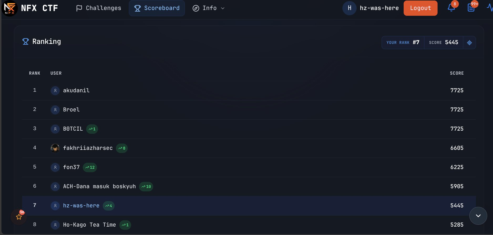

<div align="center">

# NFX CTF 2026 — Writeups

**Dokumentasi penyelesaian challenge NFX CTF 2026 oleh [Hzkun001](https://github.com/Hzkun001)** (`hz-was-here`)


[Scoreboard](#scoreboard) ·
[Daftar Writeup](#daftar-writeup) ·
[Metodologi](#metodologi) ·
[Struktur Repositori](#struktur-repositori)

</div>

---

## Scoreboard

<p align="center">
  
</p>

| | |
| --- | --- |
| **Username CTF** | `hz-was-here` |
| **Track** | Umum |
| **Platform** | NFX CTF (`ctf.nfx.my.id`) |
| **Posisi saat acara selesai** | **Peringkat #5** |
| **Posisi pada snapshot** | Peringkat #7 — 5.445 poin |
| **Total solve terdokumentasi** | **33 challenge** (23 Medium · 9 Hard · 1 Insane) |
| **Bukti arsip** | [assets/scoreboard/README.md](assets/scoreboard/README.md) |

> [!IMPORTANT]
> **Catatan posisi scoreboard.** Saat kompetisi berakhir, posisi akun seharusnya berada di **Peringkat #5**. Pada tangkapan layar live dashboard (sekitar pukul 22:15 WIB, 13 November 2026), sistem masih mencatat **Peringkat #7** (5.445 poin). Tangkapan layar dilampirkan apa adanya untuk transparansi penilaian oleh panitia.

---

## Daftar Writeup

### Ringkasan per Kategori

| Kategori | Medium | Hard | Insane | Total |
| --- | :---: | :---: | :---: | :---: |
| Web Exploitation | 2 | – | – | 2 |
| Binary Exploitation (Pwn) | 2 | 1 | 1 | 4 |
| Reverse Engineering | 2 | 3 | – | 5 |
| Cryptography | 7 | 2 | – | 9 |
| Forensics | 2 | 1 | – | 3 |
| Miscellaneous & Logic | 5 | 1 | – | 6 |
| Boot to Root | 1 | – | – | 1 |
| OSINT | 2 | 1 | – | 3 |
| **Total** | **23** | **9** | **1** | **33** |

### Medium — 23 solve

Indeks lengkap: [medium/README.md](medium/README.md)

| Kategori | Challenge | Teknik |
| --- | --- | --- |
| Web | [NexaPartner](medium/web-exploitation/nexapartner/README.md) | Prototype pollution pada endpoint settings untuk privilege escalation ke admin audit |
| Web | [NexaIdentity](medium/web-exploitation/nexaidentity/README.md) | SQL injection / authentication bypass pada mekanisme token identity console |
| Pwn | [Pipa Nu Kotor](medium/binary-exploit-pwn/pipa-nu-kotor/README.md) | Buffer overflow dan manipulasi file descriptor / pipe I/O redirection |
| Pwn | [NFXCTF Convention](medium/binary-exploit-pwn/nfxctf-convention/README.md) | Format string untuk leak address dan arbitrary write via `%n` |
| Reverse | [Medium RC4](medium/reverse-engineering/medium-rc4/README.md) | Rekayasa balik KSA/PRGA RC4 yang dimodifikasi pada ELF stripped |
| Reverse | [Medium TEA](medium/reverse-engineering/medium-tea/README.md) | Dekripsi Tiny Encryption Algorithm dengan delta constant kustom |
| Crypto | [Black Box Protocol N4T0](medium/crypto/blackbox-protocol-n4t0/README.md) | Dekode protokol transmisi NATO fonetik dan deobfuskasi manifes spreadsheet |
| Crypto | [ECDSA Nonce Bias](medium/crypto/ecdsa-nonce-bias/README.md) | Rekonstruksi private key ECDSA via bias LSB nonce (Hidden Number Problem) |
| Crypto | [Unbreakable Delay](medium/crypto/unbreakable-delay/README.md) | Bypass time-lock puzzle / sequential delay lewat optimasi modular arithmetic |
| Crypto | [Feistel Differential](medium/crypto/feistel-differential/README.md) | Differential cryptanalysis pada cipher Feistel 4-round |
| Crypto | [Cihuy LWE](medium/crypto/cihuy-lwe/README.md) | Penyelesaian Learning With Errors via reduksi basis kisi (LLL) |
| Crypto | [Static IV Offline](medium/crypto/static-iv-offline/README.md) | Serangan static IV pada mode enkripsi CBC/CTR secara offline |
| Crypto | [RSA Coppersmith Cihuy](medium/crypto/rsa-coppersmith-cihuy/README.md) | Pemulihan plaintext RSA stereotipikal dengan Coppersmith small root |
| Forensics | [Art Evidence Secret](medium/forensics/art-evidence-secret/README.md) | Steganografi LSB pada kanal warna gambar artefak seni |
| Forensics | [Weak Handshake](medium/forensics/weak-handshake/README.md) | Rekonstruksi session key TLS dari pcap handshake yang terdegradasi |
| Misc | [Dokodemo Door](medium/miscellaneous-logic/dokodemo-door/README.md) | Analisis pergerakan logika maze teleportasi stateful |
| Misc | [The Alchemist's Sandbox](medium/miscellaneous-logic/the-alchemists-sandbox/README.md) | Bypass sandbox Python restricted execution / builtins recovery |
| Misc | [Stay](medium/miscellaneous-logic/stay/README.md) | Logika automata dan traversal node interaktif |
| Misc | [Wujud Aseli Atmin](medium/miscellaneous-logic/wujud-aseli-atmin/README.md) | Rekonstruksi file rahasia via anomali metadata dan carving bytes gambar |
| Misc | [SymHell](medium/miscellaneous-logic/symhell/README.md) | Circular symlink dan path traversal pada Unix filesystem chroot |
| Boot to Root | [Forgotten Commit](medium/boot-to-root/forgotten-commit/README.md) | Ekstraksi credential tersembunyi dari commit dangling dan git object recovery |
| OSINT | [The Ghost Operator](medium/osint/the-ghost-operator/README.md) | Riwayat transmisi digital via snapshot Wayback Machine dan geolokasi safehouse Villa Istana Bunga |
| OSINT | [Fresh Arrival](medium/osint/fresh-arrival/README.md) | Jejak kedatangan logistik, flight tracking, dan cross-referencing OSINT |

### Hard — 9 solve

Indeks lengkap: [hard/README.md](hard/README.md)

| Kategori | Challenge | Teknik |
| --- | --- | --- |
| Pwn | [TheForgottenState](hard/binary-exploit-pwn/theforgottenstate/README.md) | ROP chain dengan bypass PIE, canary, dan stack pivot |
| Reverse | [Castaway](hard/reverse-engineering/castaway/README.md) | Deobfuskasi control-flow flattening (state machine) pada binary C++ |
| Reverse | [Hard VM Bytecode](hard/reverse-engineering/vm-bytecode/README.md) | Rekayasa balik arsitektur VM kustom (opcode handler dan register dispatch) |
| Reverse | [Hard Feistel](hard/reverse-engineering/feistel/README.md) | Kriptanalisis Feistel multi-round dengan s-box non-linear |
| Crypto | [Broken Signature Scheme](hard/crypto/broken-signature-scheme/README.md) | Pemalsuan signature pada skema verifikasi yang cacat |
| Crypto | [FlagKeepers](hard/crypto/flagkeepers/README.md) | Serangan multi-party threshold signature / bypass secret sharing |
| Forensics | [Bluebird Session](hard/forensics/bluebird-session/README.md) | Memory dump forensics: ekstraksi token sesi terenkripsi dari proses yang crash |
| Misc | [My Lovely Freya](hard/miscellaneous-logic/my-lovely-freya/README.md) | Restorasi data korup berantai lewat analisis struktur chunk file |
| OSINT | [Tragedi 9/11](hard/osint/tragedi-9-11/README.md) | Penelusuran arsip intelijen terbuka, korelasi manifes penerbangan, dan validasi rekaman audio |

### Insane — 1 solve

Indeks lengkap: [insane/README.md](insane/README.md)

| Kategori | Challenge | Teknik |
| --- | --- | --- |
| Pwn | [NarrowGate](insane/binary-exploit-pwn/narrowgate/README.md) | Full chain: heap exploitation (tcache poisoning), bypass ASLR, Full RELRO, NX, PIE, dan filter seccomp, dengan shellcode minimalis lewat restricted syscalls |

---

## Metodologi

1. **Reproducible.** Tiap challenge dilengkapi skrip solver (`solve.py`) berbasis Python 3 atau toolchain terkait yang bisa dijalankan ulang untuk memvalidasi alur eksploitasi.
2. **Bukti visual asli.** Screenshot antarmuka, konsol server, rekaman paket jaringan, dan diagram penjelas disertakan agar setiap argumen teknis punya dasar yang nyata.
3. **Hipotesis dipisah dari fakta.** Setiap writeup membedakan pengujian di lingkungan lokal dari respons aktual instance server CTF.

### Tools

| Area | Tools |
| --- | --- |
| Pwn / Reversing | GDB, Pwntools, Ghidra, IDA Free, ROPgadget, Checksec |
| Web | Burp Suite, cURL, Chromium DevTools, Python Requests |
| Crypto | SageMath, PyCryptodome / Python Cryptography, Z3 |
| Forensics / OSINT | Wireshark, Tshark, Binwalk, Exiftool, open registries, Wayback Machine |

> [!NOTE]
> **Penggunaan AI.** Model AI/LLM dipakai secara proporsional sebagai asisten untuk boilerplate script, unit test scaffolding, dan penataan markdown. Seluruh logika inti dan payload eksploitasi dikurasi dan divalidasi langsung oleh peserta.

---

## Struktur Repositori

```text
nfx-ctf-writeups/
├── README.md              # Indeks utama dan rekap scoreboard
├── assets/
│   └── scoreboard/        # Bukti tangkapan layar scoreboard akhir
├── templates/
│   └── WRITEUP.md         # Template writeup
├── medium/                # 23 challenge
│   ├── web-exploitation/
│   ├── binary-exploit-pwn/
│   ├── reverse-engineering/
│   ├── crypto/
│   ├── forensics/
│   ├── miscellaneous-logic/
│   ├── boot-to-root/
│   └── osint/
├── hard/                  # 9 challenge
│   ├── binary-exploit-pwn/
│   ├── reverse-engineering/
│   ├── crypto/
│   ├── forensics/
│   ├── miscellaneous-logic/
│   └── osint/
└── insane/                # 1 challenge
    └── binary-exploit-pwn/
```

Setiap folder challenge berdiri sendiri:

| Berkas | Isi |
| --- | --- |
| `README.md` | Analisis masalah, rincian kelemahan, alur eksploitasi bertahap, dan flag |
| `solve.py` / `test_solve.py` | Skrip solver otomatis dan pembuktiannya |
| `assets/` | Bukti visual (screenshot, diagram, arsip terdekripsi, atau file input) |
