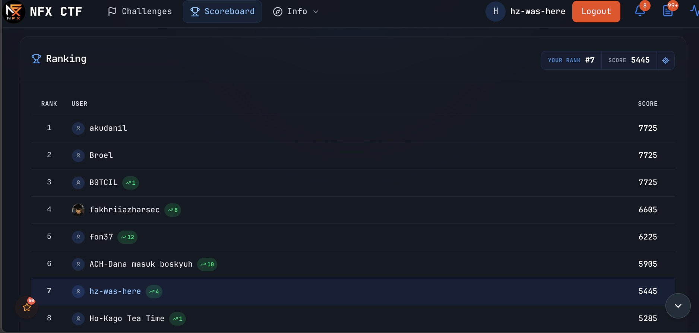

# Bukti Scoreboard Akhir NFX CTF 2026

Dokumentasi tangkapan layar posisi peserta pada platform [NFX CTF](https://ctf.nfx.my.id).

---

## Screenshot Scoreboard

---

## Ringkasan Peserta & Posisi

| Parameter | Nilai |
| --- | --- |
| **Platform** | NFX CTF (`ctf.nfx.my.id`) |
| **Username Akun** | `hz-was-here` *(hanya username, tanpa field nama pada sistem platform)* |
| **Track** | **Track Umum** |
| **Peringkat Saat Selesai Acara** | **#5** |
| **Peringkat Tercatat pada Snapshot** | **#7** (5.445 poin) |
| **Waktu Pengambilan Snapshot** | 13 November 2026, ~22:15 WIB |
| **Batas Waktu Pengumpulan** | 13 November 2026, 23:59 WIB |

---

## Catatan Posisi Scoreboard

> [!NOTE]
> * **Track & Identitas:** Akun terdaftar hanya dengan username **`hz-was-here`** pada **Track Umum**.
> * **Posisi Scoreboard:** Pada saat acara/kompetisi selesai, posisi akun seharusnya berada di **Peringkat #5**. Pada tangkapan layar dashboard yang diambil sekitar pukul 22:15 WIB tanggal 13 November 2026, antarmuka scoreboard menampilkan posisi di **Peringkat #7** (5.445 poin). Snapshot di atas dilampirkan apa adanya untuk transparansi dan verifikasi penilaian resmi oleh panitia.
