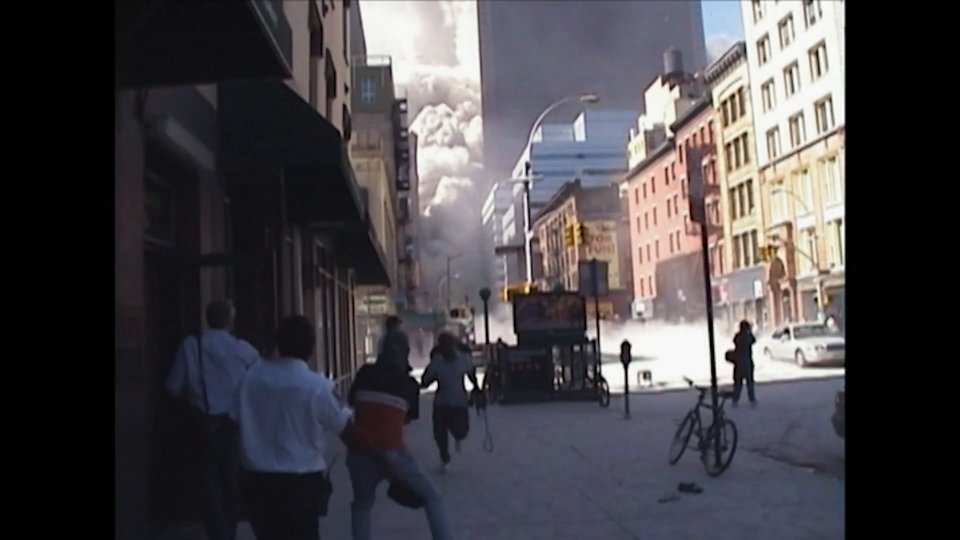

# Tragedi 9/11

[Indeks kategori](../README.md) · [Hard](../../README.md) · [Indeks utama](../../../README.md)

| Informasi | Nilai |
| --- | --- |
| Kategori | OSINT |
| Difficulty | Hard |
| Author | salep88 |
| Lampiran / sumber | `tragedi_9_11.mp4` ([Google Drive](https://drive.google.com/file/d/19FFeyJ01U0W7Ug35V1AfrYrv21VleU3e/view?usp=sharing)) |
| Verifikasi | Publik & lokal: jejak pengunggah forum `u/PigParkerPt2` dan commit `df34505` pada repositori GitHub `xor-operation` terverifikasi |

## Ringkasan

Tantangan memberikan rekaman video peristiwa 11 September 2001 (`tragedi_9_11.mp4`).
Di dalam video tampak kepulan debu runtuhnya menara World Trade Center dan seorang
pria yang membantu seorang ibu menyelamatkan diri ke dalam sebuah toko di Lower Manhattan.

Deskripsi soal memuat peringatan penting:
> *"Jangan percaya bahwa semua yang berharga dapat ditemukan dengan melihat lebih dekat. ...
> Rekaman itu dibagikan oleh seseorang di sebuah forum yang mungkin tidak asing bagi para pencari informasi.
> Jika kau menemukan videonya, jangan berhenti di sana. Perhatikan orang yang membagikannya."*

Penyelidikan tidak difokuskan pada analisis piksel atau teks toko di dalam video (seperti
logo *Elixir Juice Bar*), melainkan melacak **identitas pengunggah video di forum publik**.
Penelusuran ke forum Reddit (`r/PublicFreakout`) mengungkap nama pengguna **`u/PigParkerPt2`**.
Nama tersebut membawa ke profil GitHub `https://github.com/PigParkerPt2` dengan bio
*"I Am Neverf Forget"*. Di repositorinya (`xor-operation`), berkas pada branch utama tampak bersih,
namun pemeriksaan riwayat komit (*commit history*) pada commit `df34505` mengungkap berkas `.env`
yang memuat flag kompetisi sebelum dihapus pada commit berikutnya.

## Alur penyelesaian

### 1. Analisis awal dan peringatan soal

Berkas lampiran adalah video MP4 berdurasi 58 detik (1080p, H.264):
- SHA256 lampiran: `4e4fc09d5622a5712e02be1b87a9985ea5904fc72879590895f9c5ad4bca36f4` (35.738.008 byte).



Jika dianalisis secara visual dari dalam toko, kaca jendela memperlihatkan logo cangkir bertuliskan
*Elixir* (Elixir Juice Bar di World Financial Center/Ground Zero). Namun, petunjuk soal secara tegas menyatakan:
1. *"Jangan percaya bahwa semua yang berharga dapat ditemukan dengan melihat lebih dekat."* — detail mikroskopis di dalam video merupakan pengalih perhatian (*rabbit hole*).
2. *"Rekaman itu dibagikan oleh seseorang di sebuah forum ... Perhatikan orang yang membagikannya."* — target utama adalah **pengunggah thread di forum**.
3. *"Gunakan nama tersebut untuk mencari jejak lain yang ditinggalkannya di dunia para pembuat perangkat lunak."* — cari nama tersebut di platform pengembang (seperti GitHub).
4. *"Kau mungkin menemukan sebuah tempat yang tampaknya tidak menyimpan apa-apa. Tapi jangan hanya melihat apa yang ada sekarang."* — periksa riwayat revisi/commit yang telah dihapus.

### 2. Penelusuran pengunggah rekaman di forum publik (Reddit)

Dengan melakukan pencarian kata kunci terkait cuplikan video tersebut:
`"9/11" "store" "man helps woman" "dust" reddit`

Ditemukan unggahan video rekaman tersebut di subreddit populer `r/PublicFreakout`:
- Judul thread: rekaman dramatis saat menara WTC runtuh dan warga dievakuasi ke dalam ruko.
- Akun Reddit pengunggah thread: **`u/PigParkerPt2`**.

### 3. Pelacakan profil di platform pengembang (GitHub)

Nama pengguna **`PigParkerPt2`** kemudian ditelusuri ke GitHub:
- URL Profil: [`https://github.com/PigParkerPt2`](https://github.com/PigParkerPt2)
- Bio akun: *"I Am Neverf Forget"* (korelasi tematik kuat dengan slogan peringatan 9/11 *"Never Forget"*).
- Tanggal pembuatan akun: 1 November 2026.

Akun tersebut memiliki repositori publik bernama:
- [`xor-operation`](https://github.com/PigParkerPt2/xor-operation)

### 4. Menyelidiki riwayat commit (git commit history)

Pada branch `main` repositori `xor-operation`, struktur folder hanya berupa aplikasi Go standar
tanpa kredensial aktif:
- `main.go`
- `domain/`, `dto/`, `internal/`
- `.gitignore` (memuat pengecualian `.env`)

Sesuai petunjuk *"jangan hanya melihat apa yang ada sekarang"*, seluruh riwayat commit diperiksa
menggunakan git:

```bash
git clone https://github.com/PigParkerPt2/xor-operation
cd xor-operation
git log --oneline --stat
```

Riwayat commit menampilkan urutan:
```text
d7909fd feat : remove config in .env.example
ea765a9 chore : deleted .env
df34505 add .env
562afdcb add dto
44dbfab feat : add domain
```

Memeriksa perbedaan perubahan (*diff*) pada commit `df34505b8a8ce9a97bac2bf57fec359097a0d815`:

```bash
git show df34505
```

Hasil diff:
```diff
commit df34505b8a8ce9a97bac2bf57fec359097a0d815
Author: PigParkerPt2 <whoiami7869@gmail.com>
Date:   Sun Nov 1 22:44:47 2026 +0700

    add .env

diff --git a/.env b/.env
new file mode 100644
index 0000000..47a559b
--- /dev/null
+++ b/.env
@@ -0,0 +1,5 @@
+SERVER_HOST=localhost
+SERVER_PORT=3002
+
+
+NFX{OS1NT_DU4R_D34_D0R}
diff --git a/.env.example b/.env.example
new file mode 100644
index 0000000..32d854a
--- /dev/null
+++ b/.env.example
@@ -0,0 +1,4 @@
+SERVER_HOST=
+SERVER_PORT=
+
+NFX{OS1NT_DU4R_D34_D0R}
```

Flag `NFX{OS1NT_DU4R_D34_D0R}` ditinggalkan di dalam berkas `.env` dan `.env.example`
pada commit tersebut sebelum dihapus pada commit berikutnya (`ea765a9` dan `d7909fd`).

## Flag

```text
NFX{OS1NT_DU4R_D34_D0R}
```

## Reproduksi

Solver dan unit test hanya membutuhkan pustaka standar Python 3 (3.10+):

1. **Jalankan solver lokal:**
   ```bash
   python3 solve.py
   ```
   *Output yang diharapkan:*
   ```text
   [+] Flag berhasil dipulihkan: NFX{OS1NT_DU4R_D34_D0R}
   ```

2. **Jalankan solver secara online (langsung memverifikasi ke GitHub remote):**
   ```bash
   python3 solve.py --online
   ```

3. **Jalankan pengujian unit (unit tests):**
   ```bash
   python3 -m unittest -v test_solve.py
   ```

## Bukti

- Berkas patch commit tersimpan di [`assets/commit_df34505.patch`](assets/commit_df34505.patch) (SHA256: `5f3fd8b3fc5aa9cb0545f5d947d0af543a5e16c0df6fd73e43558af400c43f39`).
- Tangkapan layar cuplikan video tersimpan di [`assets/preview.jpg`](assets/preview.jpg).
- Teks deskripsi soal asli tersimpan di [`assets/soal.txt`](assets/soal.txt).

## Penggunaan AI (opsional)

OpenAI Codex dan Google DeepMind Antigravity membantu verifikasi rantai petunjuk soal,
pemilahan konteks forum vs artefak visual video, serta penyusunan solver dan dokumentasi pengujian.
