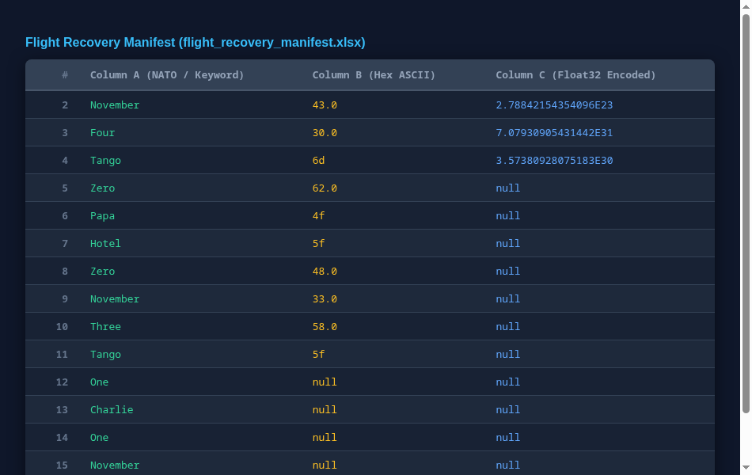

# Black Box Protocol N4T0

[Indeks kategori](../README.md) · [Medium](../../README.md) · [Indeks utama](../../../README.md)

| Informasi | Nilai |
| --- | --- |
| Kategori | Crypto |
| Difficulty | Medium |
| Input yang dianalisis | [assets/flight_recovery_manifest.xlsx](assets/flight_recovery_manifest.xlsx), workbook asli dari soal |
| Verifikasi | Lokal: float32 round-trip, mask huruf besar/kecil/angka, dan panjang bagian diverifikasi |

## Ringkasan

Soal memberi workbook `flight_recovery_manifest.xlsx` dengan satu sheet
terlihat bernama `Mail_Black_Box`. Tiga kolomnya masing-masing menyimpan satu
lapisan encoding: **kolom A** ejaan NATO + kata angka Inggris, **kolom B**
hexadecimal ASCII (sebagian tersimpan sebagai teks, sebagian sebagai angka),
dan **kolom C** bilangan yang bila di-*pack* sebagai **IEEE754 float32
big-endian** menghasilkan byte ASCII. Menggabungkan ketiganya dengan pola
`NFX{...}` menghasilkan flag.

## Alur penyelesaian

### 1. Baca workbook tanpa menjalankannya

XLSX adalah ZIP; baca `xl/sharedStrings.xml` dan `xl/worksheets/sheet1.xml`
langsung dengan pustaka standar. Jangan buka di Excel/LibreOffice karena itu
menjalankan berkas yang tidak dipercaya.

Berkas input: **5.823 byte**, SHA256
`afeb670e8f99e98968d8d1d14db12f267ac2b639ae47ce4602992bfe76518b3b`.



### 2. Kolom A — ejaan NATO dan angka

`A2:A16` (15 sel) berisi kata seperti `November`, `Four`, `Tango`, `Zero`,
`Papa`, `Hotel`, `Three`, `One`, `Charlie`. Inisialnya membentuk:

```text
N4T0PH0N3T1C1N1
```

Dari format kata dan mask huruf yang diberikan soal, bagian ini dipecah
menjadi `N4T0` / `PH0N3T1C` / `1N1`.

### 3. Kolom B — hexadecimal ASCII

`B2:B11` berisi nilai campuran: teks hex seperti `6d`, `4f`, `5f` dan angka
yang sebenarnya teks hex yang tersimpan sebagai number (`43.0`, `30.0`,
`62.0`, `48.0`, `33.0`, `58.0`). Setelah dinormalisasi lewat `Decimal` lalu
dikonversi ke integer basis-16 dan di-`chr`, kolom ini menghasilkan:

```text
C0mbO_H3X_
```

### 4. Kolom C — reinterpretasi bit float32

`C2:C4` menyimpan bilangan desimal besar. Hipotesis awal "decode sebagai
integer desimal" salah. Yang benar: *pack* setiap bilangan sebagai
**float32 big-endian**, lalu baca 4 byte-nya sebagai ASCII:

| Sel | Nilai tersimpan | float32 (hex) | ASCII |
| --- | --- | --- | --- |
| C2 | `2.78842154354096E23` | `666c3041` | `fl0A` |
| C3 | `7.07930905431442E31` | `745f6234` | `t_b4` |
| C4 | `3.57380928075183E30` | `72346e67` | `r4ng` |

Gabungannya: `fl0At_b4r4ng`. Catatan presisi: nilai sumber terpotong di
sekitar 15 digit signifikan, tetapi kesalahan relatifnya di bawah `3e-15`,
jauh di bawah ambang pembulatan float32, sehingga semua 32 bit asli
terpulihkan. Validasi yang benar memakai toleransi kesalahan relatif
`<= 1e-12`, bukan pencocokan string yang kaku.

### 5. Gabungkan dan verifikasi mask

Flag dibentuk sebagai `NFX{` + `A` (dipisah `_`) + `_` + `B` + `C` + `}`:

```text
NFX{N4T0_PH0N3T1C_1N1_C0mbO_H3X_fl0At_b4r4ng}
```

Mask huruf besar/kecil/angka dari flag harus sama persis dengan mask yang
diberikan soal:

```text
XXX{X0X0_XX0X0X0X_0X0_X0xxX_X0X_xx0Xx_x0x0xx}
```

## Flag

```text
NFX{N4T0_PH0N3T1C_1N1_C0mbO_H3X_fl0At_b4r4ng}
```

## Reproduksi

Hanya butuh pustaka standar Python (3.10+):

```bash
python3 solve.py            # memakai assets/flight_recovery_manifest.xlsx
python3 -m unittest -v      # tiga tes
```

[Solver](solve.py) memeriksa SHA256 input, membaca ZIP/XML, mendekode tiga
kolom, dan memverifikasi toleransi float32 serta mask akhir. Tiga tes mencakup
reproduksi flag, penolakan input yang diubah, dan pencocokan mask. Berkas
masukan tidak diubah.

## Bukti

- [Workbook asli](assets/flight_recovery_manifest.xlsx), SHA256
  `afeb670e…8b3b`.
- Tabel decoding kolom A/B/C di atas.

## Penggunaan AI

OpenAI Codex membantu pembacaan XML workbook, pengujian hipotesis kolom C
(float32 vs integer), dan penyuntingan writeup.
