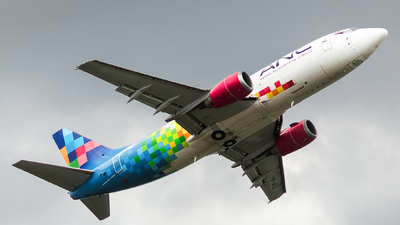
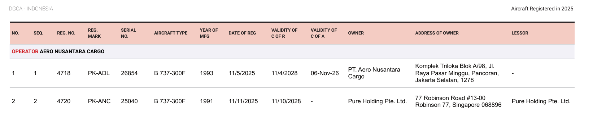
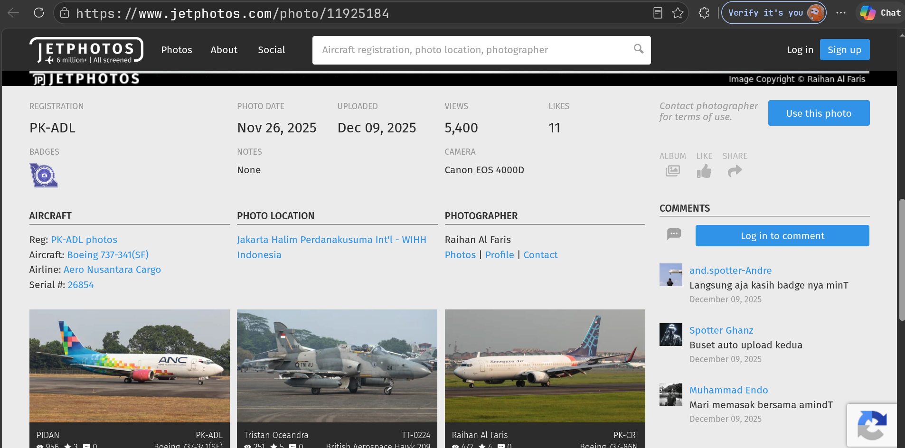
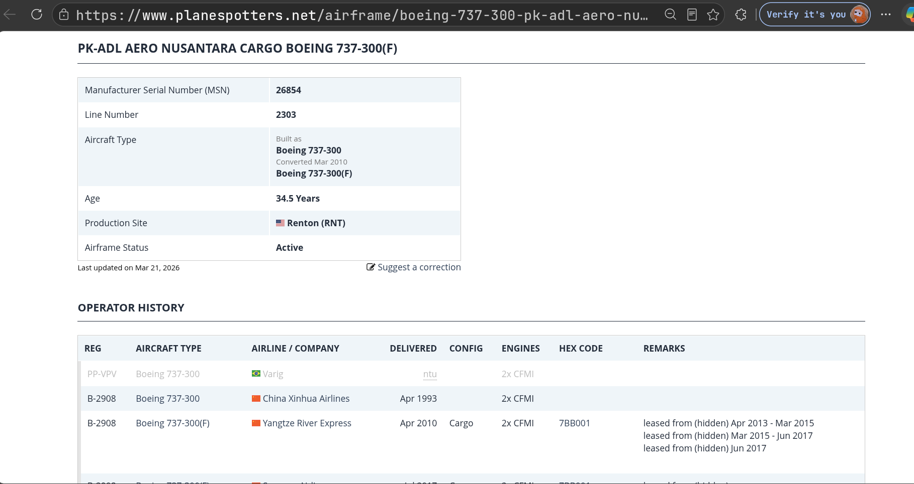
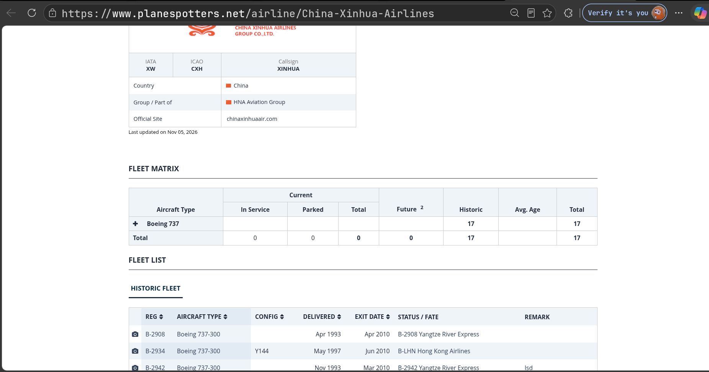

# Fresh Arrival

[Indeks kategori](../README.md) · [Medium](../../README.md) · [Indeks utama](../../../README.md)

| Informasi | Nilai |
| --- | --- |
| Kategori | OSINT |
| Difficulty | Medium |
| Author | ariaf |
| Lampiran / sumber | [assets/spotted.jpg](assets/spotted.jpg) |
| Verifikasi | Lokal & accepted oleh platform; penelusuran registrasi PK-ADL, konfirmasi MSN 26854 via Kemenhub, kredit fotografer JetPhotos Raihan Al Faris, dan riwayat operator pertama China Xinhua Airlines terverifikasi |

## Ringkasan

Tantangan memberikan sebuah foto pesawat kargo bertuliskan *Aero Nusantara Cargo* (`assets/spotted.jpg`) yang dilaporkan terlihat di Jakarta pada akhir November 2025. Penyelidikan menuntut dua sasaran utama:
1. Menemukan identitas fotografer asli yang mengabadikan foto pesawat kargo tersebut.
2. Menelusuri riwayat badan pesawat (*airframe*) hingga menemukan operator pertama yang menerima dan mengoperasikannya secara resmi setelah keluar dari pabrik Boeing.

Melalui pembacaan visual bodi pesawat, diperoleh kode registrasi **PK-ADL**. Pengecekan pada dokumen resmi **Civil Aircraft Register (CAR) 2026** dari Direktorat Jenderal Perhubungan Udara Kemenhub RI mengonfirmasi nomor seri pabrik (*Manufacturer Serial Number* / MSN) yaitu **26854** (tipe Boeing 737-341(SF) buatan tahun 1993). Penelusuran pada basis data aviasi JetPhotos mencocokkan foto di Bandara Internasional Halim Perdanakusuma (WIHH) tertanggal 26 November 2025 dengan fotografer asli bernama **Raihan Al Faris** (komponen nama depan: `raihan`).

Pelacakan riwayat airframe MSN 26854 melalui Airfleets, Planespotters, dan RZJets mengungkap bahwa pemesan awal (Varig) berstatus *NTU (Not Taken Up)*, sehingga operator komersial pertama yang benar-benar menerima penyerahan pesawat pada 15 April 1993 adalah **China Xinhua Airlines**. Maskapai ini memiliki kode IATA **`XW`**, kode ICAO **`CXH`**, dan berkantor pusat di **Beijing, China** (`beijing`). Menggabungkan seluruh komponen sesuai format `NFX{IATA_ICAO_kota_namadepan}` menghasilkan flag valid.

## Alur penyelesaian

### 1. Pemeriksaan awal & petunjuk visual lampiran

| Berkas | Ukuran | SHA256 |
| --- | --- | --- |
| `assets/spotted.jpg` | 68.302 B | `1b74fef0e79aae45c0a5adc275124f2b996b67547f1a39180451ce9750cf4600` |



Pemeriksaan visual langsung pada foto soal:
- Operator tertera pada badan pesawat: **Aero Nusantara Cargo**.
- Kode registrasi pesawat pada bagian belakang bodi: **PK-ADL**.
- Tipe visual pesawat: Boeing 737 generasi Classic (-300/400 Freighter).
- Konteks peristiwa: Pesawat kargo baru yang mendarat di Jakarta pada akhir November 2025.

### 2. Konfirmasi identitas pesawat & MSN (Kemenhub CAR 2026)

Karena registrasi pesawat dapat berpindah tangan atau berganti saat diekspor, registrasi `PK-ADL` ditelusuri ke dokumen registrasi pesawat resmi pemerintah Indonesia: **Civil Aircraft Register (CAR) 2026** yang diterbitkan oleh Direktorat Jenderal Perhubungan Udara, Kementerian Perhubungan RI.



Dokumen pemerintah mencatat baris data pesawat:
- **Operator:** PT Aero Nusantara Cargo
- **Registration:** `PK-ADL`
- **Aircraft Type:** `B 737-300F`
- **Manufacturer Serial Number (MSN):** **`26854`**
- **Year of Manufacture:** 1993

Nilai MSN `26854` menjadi pengenal unik permanen untuk melacak sejarah airframe lintas operator dunia.

### 3. Pelacakan foto sumber & fotografer asli (JetPhotos)

Pencarian basis data foto aviasi (JetPhotos) menggunakan kata kunci registrasi `PK-ADL` dan filter lokasi Jakarta menghasilkan entri foto spesifik:



Metadata foto pada JetPhotos (Photo ID: `11925184`):
- **Aircraft:** Boeing 737-341(SF)
- **Registration:** `PK-ADL`
- **MSN:** `26854`
- **Airport:** Jakarta Halim Perdanakusuma International Airport (WIHH / HLP)
- **Date Taken:** 26 November 2025
- **Date Uploaded:** 9 Desember 2025
- **Photographer:** **Raihan Al Faris**

Tanggal dan lokasi cocok dengan petunjuk challenge ("terlihat di Jakarta pada akhir November 2025"). Nama depan fotografer yang diambil untuk komponen flag adalah **`raihan`**.

### 4. Penelusuran riwayat airframe berdasarkan MSN 26854

Pencarian rekam jejak airframe dilakukan menggunakan **MSN 26854** pada platform intelijen aviasi (Planespotters, Airfleets, dan RZJets):



Kronologi operator airframe MSN 26854:

| Periode | Registrasi | Operator | Catatan Operasional |
| --- | --- | --- | --- |
| 1992 | `PP-VPC` | *(Varig)* | Penerbangan uji coba; status tercatat `VARIG PP-VPC NTU` (*Not Taken Up* - batal diambil) |
| **April 1993** | **`B-2908`** | **China Xinhua Airlines** | **Penyerahan komersial pertama resmi (15 April 1993)** |
| April 2010 | `B-2908` | Yangtze River Express | Dikonversi menjadi kargo (Special Freighter) |
| Juli 2017 | `B-2908` | Suparna Airlines | Operasi kargo |
| April 2021 | `B-2908` | Central Airlines | Operator kargo terakhir di Tiongkok |
| November 2025 | `PK-ADL` | Aero Nusantara Cargo | Diimpor ke Indonesia dan mulai beroperasi |

*Analisis operator pertama:* Pesawat melakukan penerbangan perdana pada 28 Mei 1992 dengan registrasi uji Brasil `PP-VPC` yang dialokasikan untuk Varig. Namun, catatan RZJets dan Planespotters menegaskan status `NTU` (*Not Taken Up*). Pengiriman operasional pertama secara resmi dilakukan ke **China Xinhua Airlines** pada tanggal 15 April 1993. Dengan demikian, operator pertama adalah **China Xinhua Airlines**.

### 5. Penentuan kode maskapai & kota markas

Setelah nama maskapai operator pertama dipastikan (**China Xinhua Airlines**), dilakukan penelusuran identitas maskapai penerbangan sipil:



1. **Kode IATA:**
   - Planespotters dan TravelSky (China BSP Airline Index) mencatat kode IATA maskapai sebagai **`XW`**.
2. **Kode ICAO:**
   - Dokumen resmi Federal Aviation Administration (FAA Order 7340.2A) mencatat `CHINA XINHUA AIRLINES` dengan kode ICAO **`CXH`** dan callsign `XINHUA`.
3. **Kota Markas (Headquarters):**
   - China Xinhua Airlines didirikan dan berkantor pusat di **Beijing, China** (distrik Chaoyang).
   - Format flag mensyaratkan huruf kecil: **`beijing`**.

### 6. Rekonstruksi komponen flag

Format flag:
```text
NFX{IATA_ICAO_kota_namadepan}
```

Rincian pemetaan nilai:

| Komponen | Nilai | Sumber Verifikasi |
| --- | --- | --- |
| IATA | `XW` | Planespotters & TravelSky BSP Index |
| ICAO | `CXH` | FAA Order 7340.2A |
| Kota markas | `beijing` | Headquarters China Xinhua Airlines (Beijing, China) |
| Nama depan fotografer | `raihan` | Kredit JetPhotos ID #11925184 (Raihan Al Faris) |

Penggabungan seluruh elemen menghasilkan string flag utuh:
```text
NFX{XW_CXH_beijing_raihan}
```

## Flag

```text
NFX{XW_CXH_beijing_raihan}
```

## Reproduksi

Skrip Python mandiri disediakan untuk memvalidasi format dan komponen flag secara otomatis:

```bash
# 1. Jalankan solver
python3 solve.py

# 2. Jalankan unit test otomatis
python3 test_solve.py
```

Keluaran solver:
```text
[+] Recovered Flag: NFX{XW_CXH_beijing_raihan}
```

## Bukti

- Berkas soal tantangan: [assets/spotted.jpg](assets/spotted.jpg).
- Bukti pendaftaran pesawat Ditjen Hubud: [assets/kemenhub_car_pk-adl.png](assets/kemenhub_car_pk-adl.png).
- Bukti kredit foto JetPhotos: [assets/jetphotos_pk-adl.png](assets/jetphotos_pk-adl.png).
- Bukti riwayat airframe MSN 26854: [assets/airframe_history_msn26854.png](assets/airframe_history_msn26854.png).
- Bukti data maskapai China Xinhua Airlines: [assets/china_xinhua_airlines_info.png](assets/china_xinhua_airlines_info.png).
- Skrip solver: [solve.py](solve.py).
- Pengujian unit otomatis: [test_solve.py](test_solve.py).

## Referensi

1. [Kementerian Perhubungan RI — Civil Aircraft Register 2026 (PDF via Wayback Machine)](http://web.archive.org/web/20260417083344/https://imsis-djpu.kemenhub.go.id/PortalDKPPU/CAR2026Digital.pdf)
2. [JetPhotos — PK-ADL Boeing 737-341(SF) photo by Raihan Al Faris (#11925184)](https://www.jetphotos.com/photo/11925184)
3. [Planespotters — PK-ADL Aero Nusantara Cargo Boeing 737-300 (MSN 26854)](https://www.planespotters.net/airframe/boeing-737-300-pk-adl-aero-nusantara-cargo/3w70qr)
4. [Airfleets — Boeing 737 MSN 26854 / PK-ADL](https://www.airfleets.es/ficheapp/plane-b737-26854.htm)
5. [RZJets — Boeing 737-341 MSN 26854](https://rzjets.net/aircraft/?typ=1946)
6. [Planespotters — China Xinhua Airlines Fleet & History](https://www.planespotters.net/airline/China-Xinhua-Airlines)
7. [FAA — Order 7340.2A Change 1 Contractions (PDF)](https://www.faa.gov/documentLibrary/media/Order/7340.2ACHG1.pdf)
8. [TravelSky — Reservation Manual, Appendix 5: China BSP Airline Index (PDF)](https://cdn.flyscoot.com/prod/docs/default-source/doc-agents/travelsky.pdf)

## Penggunaan AI

Struktur writeup, tabel kronologi airframe, dan skrip verifikasi otomatis diformat dengan bantuan AI untuk memastikan keselarasan penuh terhadap standar dokumentasi repositori.
