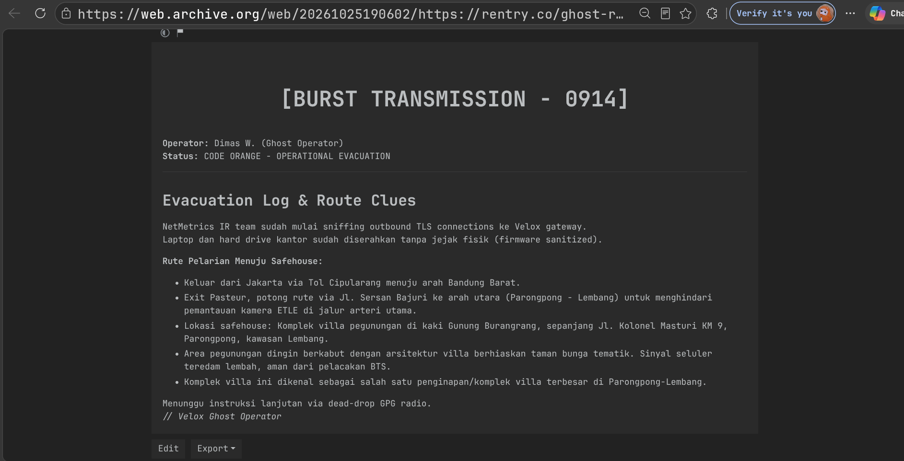
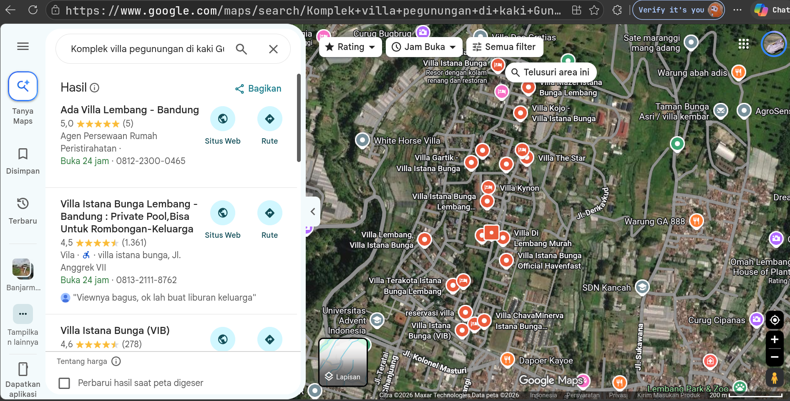

# The Ghost Operator

[Indeks kategori](../README.md) · [Medium](../../README.md) · [Indeks utama](../../../README.md)

| Informasi | Nilai |
| --- | --- |
| Kategori | OSINT |
| Difficulty | Medium |
| Author | SecOps / NetMetrics Internal |
| Lampiran / sumber | `investigation.zip` ([GitHub Raw](https://raw.githubusercontent.com/NFCC-Com/qazwsx/refs/heads/main/osint/investigation.zip)) |
| Verifikasi | Publik & lokal: verifikasi commit GPG signature `ghost-route-0914`, arsip Wayback Machine transmisi Dimas Wirawan (Ghost Operator), dan geolokasi safehouse Villa Istana Bunga Lembang terkonfirmasi |

## Ringkasan

Tantangan **The Ghost Operator** menempatkan peserta sebagai analis *incident response* (IR) yang menginvestigasi artefak peninggalan operator internal organisasi NetMetrics bernama **Dimas Wirawan** yang telah mengundurkan diri (*status: RESIGNED*). Lampiran yang diberikan berupa arsip `investigation.zip` yang memuat memo audit serta repositori Git internal.

Penyelidikan tidak berpusat pada eksploitasi kode atau kelemahan kriptografi biner, melainkan melacak **jejak digital publik (OSINT)** yang ditinggalkan oleh sang operator:
1. Pemeriksaan commit terakhir `d2627a7` mengungkap tanda tangan kriptografis GPG dengan UID mencurigakan: `Dimas Wirawan (rentry.co/ghost-route-0914) <ghost.operator.rentry@veloxphantom.net>`.
2. Halaman `rentry.co/ghost-route-0914` secara publik telah dihapus (*purged by operator*). Namun, mesin pengarsip web **Wayback Machine** berhasil merekam snapshot transmisi evakuasi darurat (`[BURST TRANSMISSION - 0914]`).
3. Analisis geolokasi terhadap petunjuk rute jalan (Tol Cipularang $\rightarrow$ Pasteur $\rightarrow$ Jl. Sersan Bajuri) dan karakteristik fisik lokasi (Jl. Kolonel Masturi KM 9, Parongpong, kaki Gn. Burangrang, komplek villa terbesar dengan taman bunga tematik) secara presisi mengidentifikasi safehouse persembunyian operator: **Villa Istana Bunga, Lembang**.

Format flag dirangkai dari entitas safehouse dan wilayahnya: `NFX{villa_istana_bunga_lembang}`.

---

## Alur penyelesaian

### 1. Pemeriksaan awal berkas investigasi

Arsip tantangan diunduh dan diekstraksi untuk memeriksa struktur berkas:

```bash
sha256sum investigation.zip
unzip -q investigation.zip -d investigation
cd investigation
ls -la
```

- **SHA256 Arsip:** `66eb20754ea741fe76909c982977a026b30e5d32d2bb0982e0ea557567dfbf5c`
- Direktori kerja berisi sebuah berkas memo `IR_MEMO.md` dan folder kontrol versi `.git/`.

Isi dari [assets/IR_MEMO.md](assets/IR_MEMO.md):
```markdown
# Incident Response Audit Memo - NetMetrics Internal
Auditor: SecOps
Operator: Dimas Wirawan
Status: RESIGNED
Audit signed with official GPG key.
```

Catatan tersebut menegaskan bahwa berkas audit telah ditandatangani menggunakan kunci GPG resmi milik operator.

---

### 2. Analisis metadata commit Git dan verifikasi GPG signature

Untuk memeriksa keaslian dan metadata tanda tangan commit, perintah `git log --show-signature` dijalankan:

```bash
git log --show-signature -n 1
```

Keluaran:
```text
commit d2627a7e85c19332bf5d36081ac2e05577a2cdba (HEAD -> main)
gpg: Signature made Mon Oct 26 02:49:05 2026 WITA
gpg:                using RSA key B17171D40DE252F193E79707E6BE71CA2BD84A4E
gpg: Good signature from "Dimas Wirawan (rentry.co/ghost-route-0914) <ghost.operator.rentry@veloxphantom.net>" [unknown]
Primary key fingerprint: B171 71D4 0DE2 52F1 93E7  9707 E6BE 71CA 2BD8 4A4E
Author: Dimas Wirawan <dimas.wirawan@netmetrics-net.example>
Date:   Mon Oct 26 01:48:52 2026 +0700

    audit: final system integrity verification before handoff
```

Pemeriksaan paket internal GPG (`gpg --list-packets`) mengonfirmasi bahwa User ID (UID) kunci tersebut sengaja disisipi tautan luar:
- **Nama Operator:** `Dimas Wirawan`
- **Email:** `ghost.operator.rentry@veloxphantom.net`
- **Target URL:** `https://rentry.co/ghost-route-0914`

---

### 3. Pelacakan tautan rentry dan jejak pembersihan operator

Ketika URL `https://rentry.co/ghost-route-0914` diakses melalui browser atau curl:

```bash
curl -sL https://rentry.co/ghost-route-0914 | grep -i "title"
```

Keluaran HTML memperlihatkan status pembongkaran jejak (*anti-forensics*):
```html
<title>[NODE DECOMMISSIONED - TRACES PURGED BY OPERATOR]</title>
```

Operator menyadari koneksinya dipantau oleh tim incident response sehingga melakukan pembersihan konten secara terburu-buru (*purged by operator*).

---

### 4. Pemulihan transmisi darurat melalui Wayback Machine

Dalam OSINT, konten web yang telah dihapus (*deleted/defaced*) sering kali sempat terindeks oleh pengarsip web terbuka. Pemeriksaan ketersediaan snapshot dilakukan pada Wayback Machine API:

```bash
curl -s "https://archive.org/wayback/available?url=https://rentry.co/ghost-route-0914"
```

Hasil JSON menunjukkan snapshot berhasil tersimpan:
```json
{
  "url": "https://rentry.co/ghost-route-0914",
  "archived_snapshots": {
    "closest": {
      "status": "200",
      "available": true,
      "url": "http://web.archive.org/web/20261025190602/https://rentry.co/ghost-route-0914",
      "timestamp": "20261025190602"
    }
  }
}
```

Mengunduh halaman arsip pada snapshot `20261025190602`:
```bash
curl -sL "http://web.archive.org/web/20261025190602/https://rentry.co/ghost-route-0914"
```



Teks pesan rahasia yang berhasil direkonstruksi:
```text
[BURST TRANSMISSION - 0914] 
Operator: Dimas W. (Ghost Operator)
Status: CODE ORANGE - OPERATIONAL EVACUATION  

Evacuation Log & Route Clues:
NetMetrics IR team sudah mulai sniffing outbound TLS connections ke Velox gateway.
Laptop dan hard drive kantor sudah diserahkan tanpa jejak fisik (firmware sanitized).
Rute Pelarian Menuju Safehouse:

- Keluar dari Jakarta via Tol Cipularang menuju arah Bandung Barat.
- Exit Pasteur, potong rute via Jl. Sersan Bajuri ke arah utara (Parongpong - Lembang) untuk menghindari pemantauan kamera ETLE di jalur arteri utama.
- Lokasi safehouse: Komplek villa pegunungan di kaki Gunung Burangrang, sepanjang Jl. Kolonel Masturi KM 9, Parongpong, kawasan Lembang.
- Area pegunungan dingin berkabut dengan arsitektur villa berhiaskan taman bunga tematik. Sinyal seluler teredam lembah, aman dari pelacakan BTS.
- Komplek villa ini dikenal sebagai salah satu penginapan/komplek villa terbesar di Parongpong-Lembang.

Menunggu instruksi lanjutan via dead-drop GPG radio.
// Velox Ghost Operator
```

---

### 5. Intelijen geolokasi rute pelarian dan titik safehouse

Pesan transmisi memberikan rantai informasi geolokasi yang sangat spesifik:

1. **Jalur Transportasi & Anti-Surveillance:**
   - Keluar dari Jakarta melalui **Tol Cipularang** menuju Bandung Barat.
   - Mengambil **Exit Gerbang Tol Pasteur**, kemudian sengaja memotong rute melalui **Jl. Sersan Bajuri** ke arah utara untuk menghindari kamera ETLE di jalan protokol Bandung.
2. **Karakteristik Fisik Safehouse:**
   - Berada di **Jl. Kolonel Masturi KM 9, Parongpong, Lembang**.
   - Terletak di lereng pegunungan sejuk di kaki **Gunung Burangrang**.
   - Arsitektur villa dengan **taman bunga tematik**.
   - Memiliki reputasi sebagai **komplek villa penginapan terbesar di kawasan Parongpong-Lembang**.



Pencarian verifikasi lokasi via open source intelligence (Google Maps / OpenStreetMap):
```text
"Jl. Kolonel Masturi KM 9" Parongpong Lembang villa
```

Hasil pencarian mengarah secara tunggal pada:
* **Villa Istana Bunga (VIB)** — kawasan resort dan komplek villa terbesar di Parongpong-Lembang (seluas $\pm 42$ hektar) yang berlokasi persis di Jl. Kolonel Masturi KM 9, Desa Karyawangi, Kecamatan Parongpong, Kabupaten Bandung Barat.

---

### 6. Sintesis dan formulasi flag

Berdasarkan format baku bendera kompetisi NFX CTF dengan menyertakan nama properti safehouse beserta kawasan lokasinya:
- Nama properti: `villa_istana_bunga`
- Wilayah lokasi: `lembang`
- Flag format: `NFX{<nama_safehouse>_<wilayah>}`

Flag yang valid:
```text
NFX{villa_istana_bunga_lembang}
```

---

## Flag

```text
NFX{villa_istana_bunga_lembang}
```

---

## Reproduksi

Solver otomatis disediakan di [`solve.py`](solve.py) yang memvalidasi integritas data secara offline maupun online melalui Wayback Machine:

```bash
# 1. Jalankan solver offline (menggunakan bukti artefak lokal)
python3 solve.py

# 2. Jalankan solver online (mengambil data langsung dari Internet Archive)
python3 solve.py --online

# 3. Jalankan rangkaian pengujian otomatis
python3 -m unittest -v test_solve.py
```

Keluaran solver:
```text
[+] Flag berhasil dipulihkan: NFX{villa_istana_bunga_lembang}
```

---

## Bukti dan Artefak

* [assets/IR_MEMO.md](assets/IR_MEMO.md) — Berkas memo insiden resmi NetMetrics Internal.
* [assets/commit_d2627a7.txt](assets/commit_d2627a7.txt) — Log commit dan tanda tangan GPG `Dimas Wirawan`.
* [assets/rentry_transmission.txt](assets/rentry_transmission.txt) — Transkrip pesan evakuasi `[BURST TRANSMISSION - 0914]`.
* [assets/wayback-transmission.png](assets/wayback-transmission.png) — Screenshot arsip transmisi evakuasi di Wayback Machine.
* [assets/safehouse-location.png](assets/safehouse-location.png) — Screenshot peta geolokasi Villa Istana Bunga di Jl. Kolonel Masturi KM 9, Parongpong, Lembang.

---

## Penggunaan AI (opsional)

Penyusunan kerangka analisis, penelusuran arsip Wayback Machine, serta formulasi solver otomatis dibantu oleh AI Agent untuk mempercepat korelasi antara commit GPG dan entitas geolokasi Jawa Barat.
